

# CYBERIA — Digital Learning Platform

### Making digital education more accessible through structured, practical, and self-paced learning.

<a href="https://cyberiatech.netlify.app">
<strong>Visit the Live Platform</strong>
</a>

---

# Executive Summary

CYBERIA is a student-led educational technology platform designed to make digital education more accessible through structured, practical, and self-paced learning.

The project was created with a simple objective: help beginners develop essential technology skills through a learning environment that combines clear explanations, practical activities, interactive assessments, and progressive skill development.

Started while I was still in high school, CYBERIA became a real-world application of my interests in software development, cybersecurity, artificial intelligence, and digital education.

The platform currently provides bilingual learning resources in French and English across six available courses:

- Computer Fundamentals
- Microsoft Word
- Microsoft Excel
- Microsoft PowerPoint
- Python Programming
- Cybersecurity Fundamentals

CYBERIA also has plans to expand into artificial intelligence, networking and systems, and technology and innovation.

Beyond being a learning platform, CYBERIA represents an ongoing engineering journey: transforming ideas into a functional product while continuously improving its architecture, security, accessibility, and educational experience.

---

## Repository Note

This repository serves as a public documentation and showcase space for CYBERIA.

The production source code is currently private to protect the platform's infrastructure and ongoing development process.

This repository provides:

- Project documentation
- Interface screenshots
- Technical overview
- Development journey
- Future roadmap

The live platform remains publicly accessible through the link above.

---

# Why CYBERIA?

While learning programming and cybersecurity, I noticed that many beginners faced difficulties finding learning resources that were structured, accessible, and adapted to their level.

Many existing platforms provide valuable content, but learning materials can be fragmented across multiple websites, assume previous technical knowledge, or limit access to advanced features behind paid subscriptions.

CYBERIA was created to address this challenge by providing a progressive learning environment where students can:

- Learn essential digital skills from the basics
- Follow structured learning paths
- Practice through interactive activities
- Track their progress
- Evaluate their understanding
- Develop confidence through continuous learning

At the same time, CYBERIA became my personal engineering laboratory. Each feature allowed me to apply concepts learned in programming, web development, cybersecurity, and artificial intelligence to a real-world product.

---

# Platform Overview

CYBERIA is a bilingual digital learning platform focused on practical technology education.

| Category | Details |
| --- | --- |
| Platform Type | Educational Technology Platform |
| Languages | French and English |
| Target Users | Beginners, students, and self-learners |
| Available Courses | 6 |
| Learning Modules | 44 |
| Quiz Questions | 440 |
| Question Explanations | 440 |
| Final Exam Format | 20 randomly selected questions |
| Authentication | Firebase Authentication |
| Database | Firebase Firestore |
| Serverless Backend | Netlify Functions |
| AI Integration | Groq API |
| Deployment | Netlify |
| Development Status | Active Development |

---

# Learning Academies

CYBERIA is organized around six educational areas.

## 1. Digital Skills Academy

Helps learners develop essential computer and office productivity skills.

Available courses:

- Computer Fundamentals
- Microsoft Word
- Microsoft Excel
- Microsoft PowerPoint

## 2. Programming Academy

Introduces learners to programming through beginner-friendly explanations and practical exercises.

Available course:

- Python Programming

## 3. Cybersecurity Academy

Introduces learners to digital safety, online threats, and responsible technology usage.

Available course:

- Cybersecurity Fundamentals

## 4. Artificial Intelligence Academy

Planned learning area focused on artificial intelligence concepts, tools, and practical applications.

## 5. Networking & Systems Academy

Planned learning area covering computer networks, operating systems, and essential infrastructure concepts.

## 6. Technology & Innovation Academy

Planned learning area designed to introduce learners to emerging technologies and practical innovation.

*The first three academies currently contain the six available courses. The remaining academies are part of the platform's development roadmap.*

---

# Core Features

## Structured Learning System

CYBERIA organizes educational content into progressive learning paths that allow beginners to develop skills step by step.

The six available courses contain:

| Course | Modules | Questions |
| --- | ---: | ---: |
| Computer Fundamentals | 9 | 45 |
| Microsoft Word | 8 | 40 |
| Microsoft Excel | 8 | 40 |
| Microsoft PowerPoint | 6 | 30 |
| Python Programming | 7 | 35 |
| Cybersecurity Fundamentals | 6 | 30 |
| **Total** | **44** | **220** |

Each course is available in French and English, resulting in 440 question entries across both languages.

Lessons combine explanations, examples, and interactive activities to support progressive learning.

---

## Bilingual Learning Experience

CYBERIA supports French and English to make digital education accessible to learners with different language preferences.

The bilingual architecture includes:

- French and English learning pages
- Language-specific course content
- Translated quizzes and explanations
- Language-aware navigation
- Consistent language selection across the learning experience

The platform is designed so that when a learner selects French, the interface and learning content remain in French. The same applies to English.

---

## Student Dashboard

CYBERIA provides learners with a personalized dashboard to manage their learning journey.

The dashboard allows users to:

- Access available courses
- Continue previously started lessons
- Monitor their learning progress
- View completed modules
- Navigate through their educational path

This system helps learners visualize their progress over time.

---

## Authentication System

User management is powered by Firebase Authentication.

Implemented authentication features include:

- Email and password authentication
- Google Sign-In
- Email verification
- Password recovery
- Persistent user sessions

Authentication allows CYBERIA to provide a personalized experience while managing user-specific learning data.

---

## Progress Tracking System

CYBERIA includes a progression system designed to encourage consistent learning.

Current features include:

- Lesson completion tracking
- Learning progress visualization
- User advancement indicators
- Personalized learning data

The objective is to transform online learning from a passive experience into an interactive journey.

---

## Interactive Assessments

CYBERIA integrates interactive quizzes and final examinations to help learners evaluate their understanding.

Current assessment features include:

- Module-based quizzes
- Final examinations
- Multiple-choice questions
- Answer validation
- Explanations and corrections
- Randomized final examination questions
- Server-side score calculation

Each final examination selects 20 questions from the corresponding course question bank.

The assessment system is designed to support learning and self-evaluation.

---

## Server-Side Quiz Validation

One of the major technical improvements in CYBERIA was the transition from client-side answer validation to server-side grading.

Previously, quiz-related data was handled on the client side. This architecture could expose correct answers to users inspecting browser resources.

The assessment system was redesigned to improve the separation between questions and answer keys.

The current architecture follows this process:

1. The frontend requests questions from a Netlify Function.
2. The server returns questions and answer options without exposing correct-answer indices.
3. The learner submits their answers.
4. The server validates the submission.
5. The server calculates the score using its private answer key.
6. The result and correction information are returned to the frontend.

The answer keys remain on the server rather than being included in the initial client-side question data.

This improvement makes quiz grading more resistant to simple client-side answer manipulation.

---

## AI Learning Assistant

CYBERIA integrates an AI-powered assistant designed to support learners during their educational journey.

The assistant can help students by:

- Explaining difficult concepts
- Answering programming-related questions
- Providing learning guidance
- Supporting independent study

The AI assistant uses the Groq API through a serverless backend function.

It is designed as a learning support tool that complements educational content and encourages exploration.

---

# Platform Screenshots

The following screenshots showcase the main interfaces and learning experience provided by CYBERIA.

## Homepage

### French Version

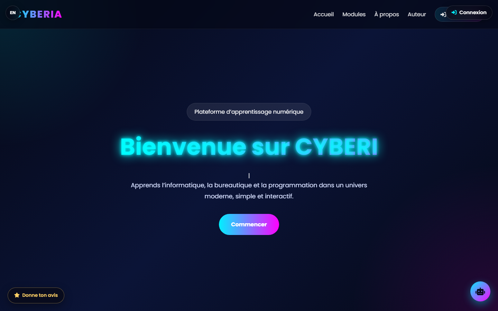

### English Version

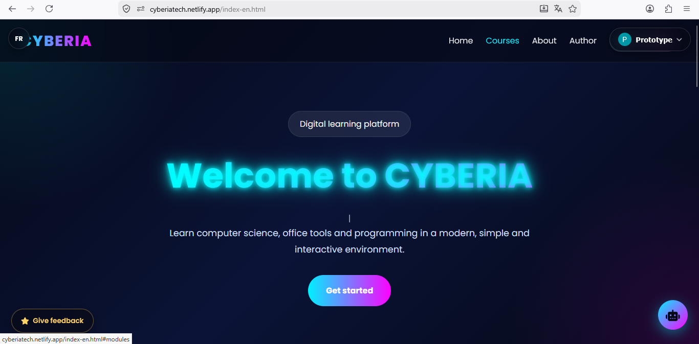

---

## Authentication System

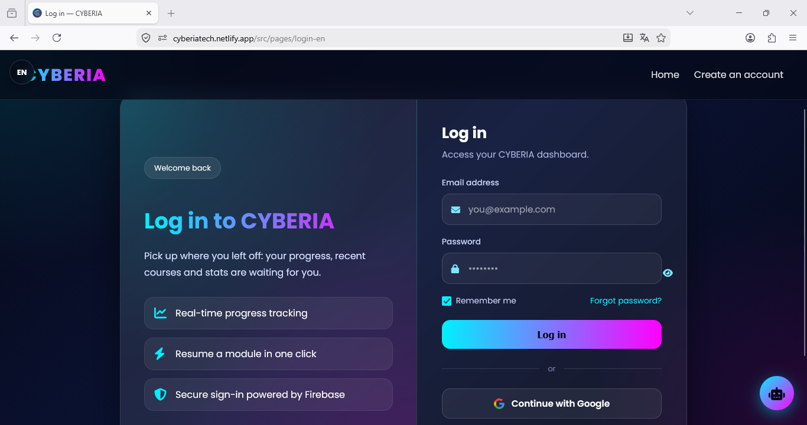

---

## Student Dashboard

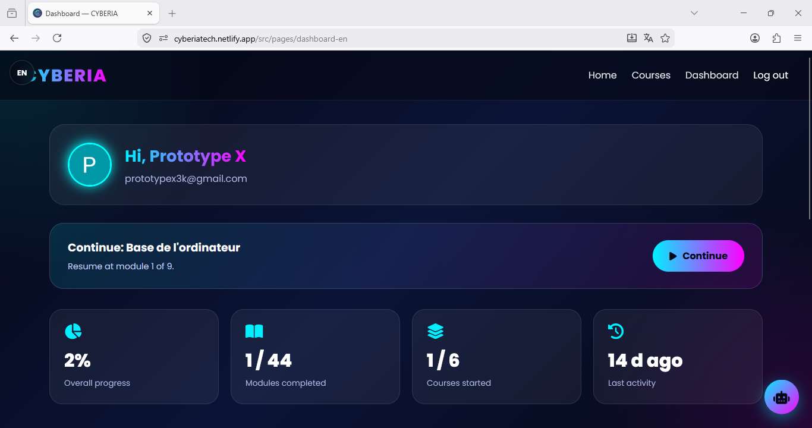

---

## Python Learning Module

### French Version

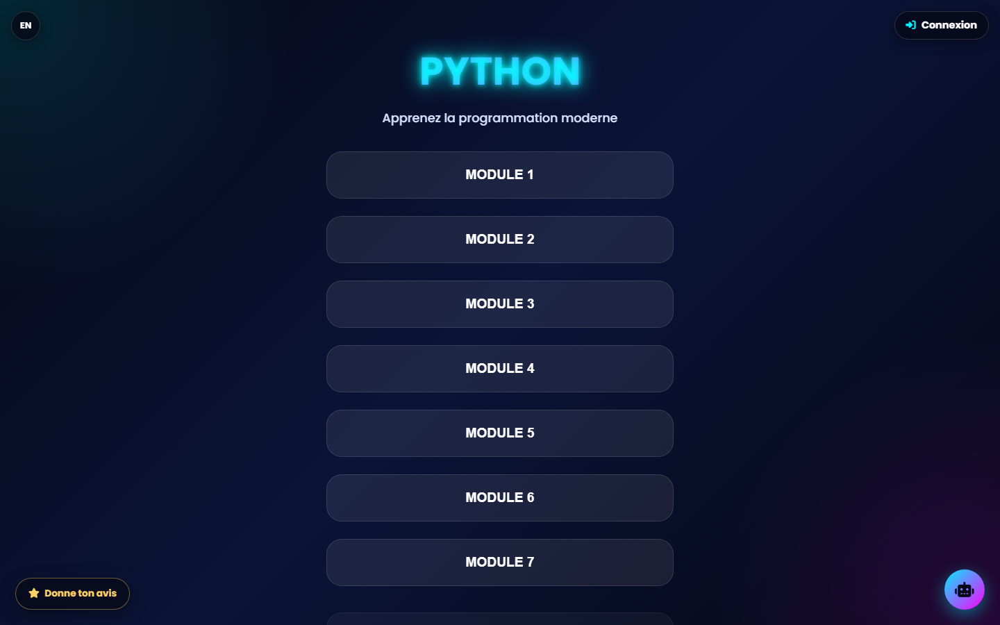

### English Version

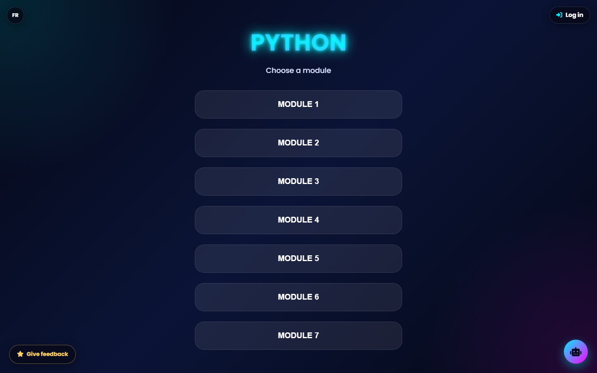

---

## Cybersecurity Learning Module

### French Version

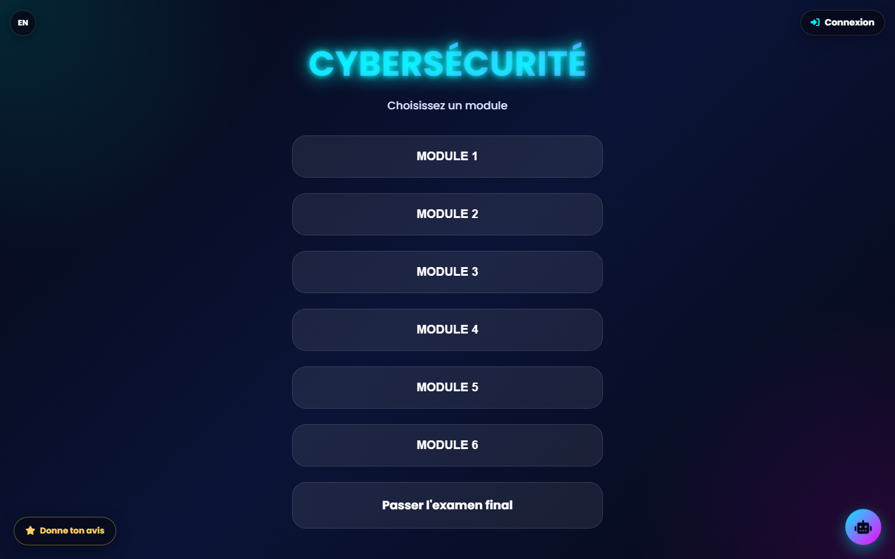

### English Version

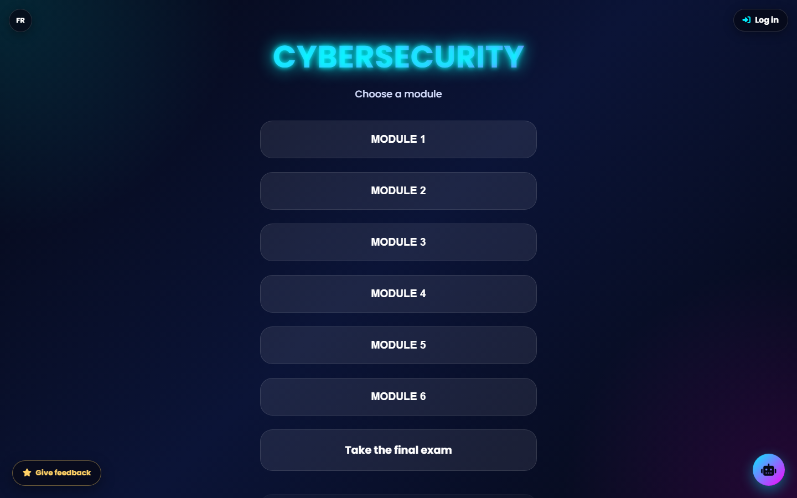

---

## AI Learning Assistant

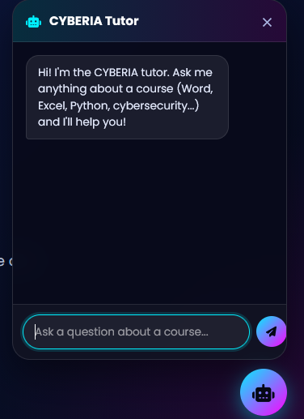

---

## Learning Progress System

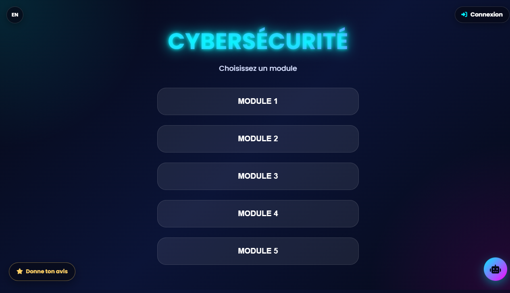

---

## About CYBERIA

### French Version

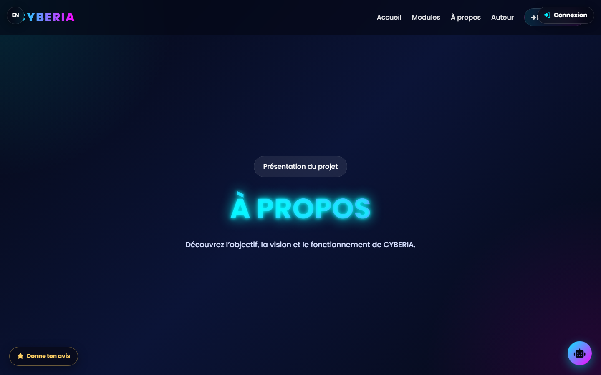

### English Version

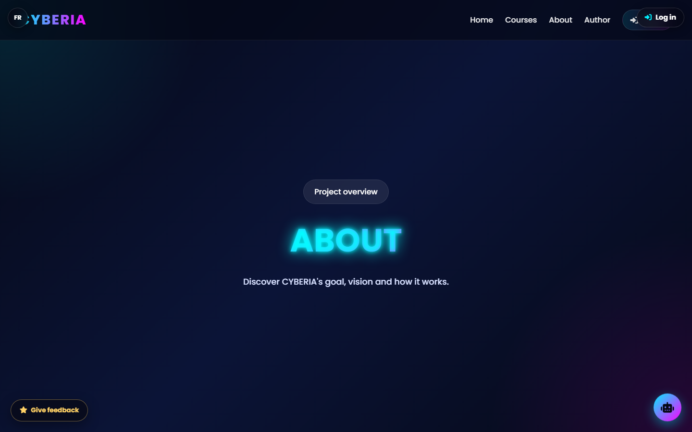

---

# Technical Architecture

CYBERIA was built using modern web technologies while maintaining a lightweight architecture suitable for accessible deployment.

## Frontend

The user interface is developed with:

- HTML5
- CSS3
- JavaScript (Vanilla JS)
- Responsive Web Design principles

The frontend focuses on providing a simple and responsive learning experience across different devices.

## Backend and Cloud Services

CYBERIA uses Firebase and Netlify Functions to manage application services.

Implemented technologies include:

- Firebase Authentication
- Firebase Firestore
- Netlify Functions
- Server-side quiz validation
- Server-side score calculation

Netlify Functions handle backend operations that should not be performed entirely in the browser.

## Artificial Intelligence

The AI learning assistant uses:

- Groq API
- Netlify Functions

API credentials are intended to remain in server-side environment variables rather than being exposed in frontend code.

## Deployment

The platform is deployed using:

- Netlify Hosting
- Netlify Functions

## Development Tools

Main development tools include:

- Visual Studio Code
- Git and GitHub
- Browser Developer Tools
- Firebase Console
- Node.js
- JavaScript testing tools

The project has been developed through continuous learning, testing, and improvement.

---

# Security and User Management

Security is an important aspect of CYBERIA, especially because the platform handles user accounts and learning progress data.

The development process includes improvements to authentication, backend validation, and the handling of assessment data.

## Implemented Security Features

Current security-related features include:

- Firebase Authentication
- User-specific learning data management
- Server-side quiz grading
- Server-side answer-key storage
- Input validation for quiz submissions
- Validation of course and question identifiers
- Client-side score values are not trusted by the grading function
- Backend API credentials managed through environment variables

## Current Security Limitations

Security remains an ongoing development process. Some limitations still need to be addressed:

- Rate limiting has not yet been implemented for quiz submissions.
- Quiz attempt recording is designed for authenticated users and requires the relevant Firebase Admin environment variables.
- Firestore attempt recording is best-effort and does not determine whether grading succeeds.
- Quiz assessments are not proctored and should be considered learning and self-evaluation tools.
- Real production-runtime verification is still required after local testing.

These limitations are part of the platform's ongoing improvement roadmap.

---

# Testing and Quality Assurance

Testing is an important part of CYBERIA's development process.

The platform's quiz architecture and core functionality have been tested through automated regression tests and direct backend handler tests.

## Latest Automated Test Results

| Test Category | Result |
| --- | ---: |
| Automated regression tests | 265 passed |
| Failed tests | 0 |
| Direct backend handler tests | 76 passed |
| Question entries | 440 |
| Course languages | 2 |
| Available courses | 6 |

The 76 backend handler tests are included in the overall test coverage reported by the project; they should not be added to the 265 total.

## Areas Covered by Testing

Testing includes:

- Quiz question retrieval
- Question identifier validation
- Answer submission validation
- Server-side score calculation
- Rejection of invalid submissions
- Course and language handling
- Final examination question selection
- Regression checks for existing functionality

Additional checks have been performed on JavaScript syntax and local project references.

*These results represent local automated testing. They do not, by themselves, establish that every feature has been verified in the live production environment.*

---

# Accessibility and User Experience

CYBERIA includes ongoing improvements intended to make the platform easier to use.

Current improvements include:

- Responsive interface design
- Keyboard focus visibility
- ARIA live regions in relevant interface components
- Reduced-motion support
- Consistent navigation
- Bilingual interface organization

Accessibility remains an area for further testing and improvement.

---

# Development Journey

CYBERIA represents more than a technical project; it is a practical learning journey.

The platform was started while I was still in high school as an opportunity to apply my knowledge of programming and technology to a real-world problem.

Through its development, I have gained experience in:

- Frontend web development
- Backend development with serverless functions
- Firebase integration
- User authentication systems
- Database management
- Server-side validation
- Web application security
- API integration
- Bilingual application architecture
- Automated testing
- UI/UX design
- Project architecture
- Problem solving and independent learning

Building CYBERIA allowed me to move beyond tutorials and create a digital product designed for real users.

The project continues to evolve through iterative development, testing, and technical improvements.

---

# Future Roadmap

CYBERIA is continuously evolving, with several improvements planned for future versions.

## Educational Improvements

- More advanced programming courses
- Expanded cybersecurity content
- Artificial intelligence learning modules
- Networking and systems courses
- Interactive practical exercises
- Expanded learning paths
- Improved assessment systems

## Security and Backend Improvements

- Rate limiting for assessment endpoints
- Further database security improvements
- Additional backend validation
- More comprehensive production testing
- Improved monitoring and error handling
- Enhanced privacy and data management practices

## Platform Improvements

- Progressive Web App (PWA) development
- Performance optimization
- Improved accessibility
- Enhanced user experience
- Better mobile experience
- Improved platform scalability

## Community Development

Future versions may include:

- Learner collaboration features
- Community learning spaces
- Mentorship opportunities
- Technology education initiatives

---

# Vision and Impact

CYBERIA aims to contribute to a future where technology education is more accessible, practical, and inclusive.

By combining digital skills training, programming education, and cybersecurity awareness, the platform seeks to help learners build the knowledge and confidence needed to participate in the digital world.

The long-term vision is to transform CYBERIA into a broader educational ecosystem that empowers students to learn, create, and innovate through technology.

---

# About the Creator

CYBERIA was created by **Josaphat Sanogo**, a student passionate about cybersecurity, artificial intelligence, software development, and digital education.

The project reflects a personal commitment to using technology as a tool for solving real-world challenges and increasing access to quality learning opportunities.

Beyond CYBERIA, Josaphat is also the co-founder of **CyberMinds**, a STEM and technology initiative focused on encouraging programming, cybersecurity awareness, and technology education among young learners.

Through these projects, the goal is to inspire students to explore technology, develop practical skills, and create solutions that can have a positive impact.

---

# Project Links

## Live Platform

https://cyberiatech.netlify.app

## Portfolio

https://sanogotajosaphatport.netlify.app

## GitHub

https://github.com/prototypeX-sys

---

# Contact

For questions, feedback, or collaboration opportunities:

**Email:**  
sanogotajosaphat2@gmail.com

---

# License and Usage

This repository is intended for documentation and project showcase purposes.

The CYBERIA platform and its associated resources are developed for educational purposes.

The production source code is currently private while development continues.

Unless a separate license is explicitly provided, the documentation in this repository does not grant permission to copy, redistribute, or commercially use the private production source code.

---

# Acknowledgments

CYBERIA was built with the support of modern web technologies, open-source tools, and educational resources that make technology development more accessible.

Special appreciation goes to the developer communities and learning platforms that contribute to the global sharing of knowledge in programming, cybersecurity, and digital innovation.

---

# Conclusion

CYBERIA represents the intersection of technology, education, and social impact.

Created as a student-led initiative, the project demonstrates how continuous learning and technology can be transformed into a practical solution for